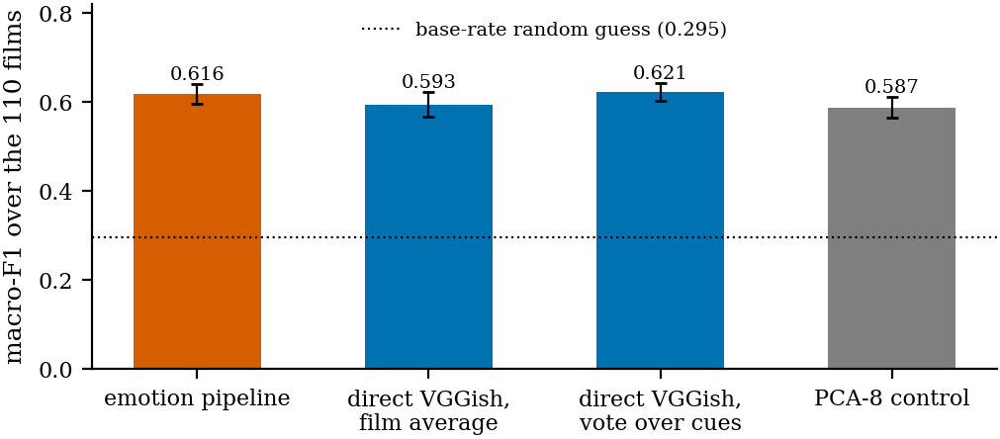
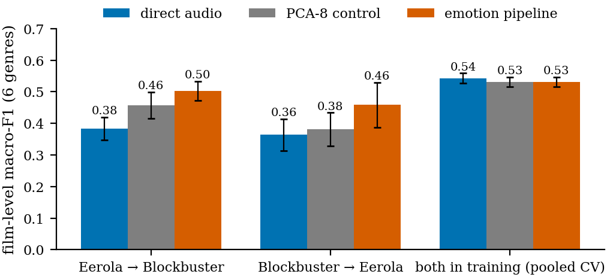
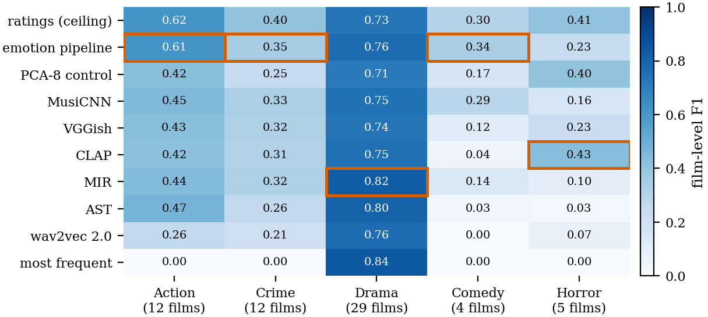

# Supervisor briefing — update since the fifth meeting (8 October 2026)

**Can a soundtrack's emotion predict a film's genre?** This page covers what was done after
the fifth meeting: the four notes, a data error found while answering the second one, and
what both changed; section 7b adds the work of 15–21 October. The briefing for the fourth meeting is archived in
`docs/archive/current_state_2026-10-07.md`; every earlier round is in `briefing_full.md`,
and every experiment in detail in the technical log, `docs/README.md` (section 24 for this
round). The thesis on Overleaf is up to date with everything below.

All genre scores are **film-level macro-F1** (the clip probabilities of a film are
averaged and the film is scored once); the clip-level value of the same predictions is
given where it matters.

---

## 1. Your notes from the meeting

Your four notes from 8 October, as written down after the meeting:

1. "Blockbuster cross validation (bar chart is ok, but with SD)"
2. "Common films between Eerola and Blockbuster should be considered in the Evaluation
   part (leakage)"
3. "Each genre: F1-score, precision and recall; check the highest model for each genre and
   maybe make a diagram out of the results"
4. "More focus in the Evaluation part on only a couple of results, so the reader is not
   distracted; be more precise in the Discussion and the whole thesis"

| # | Your note | What was done | Result |
|---|---|---|---|
| 1 | Blockbuster cross-validation as a bar chart, but with SD | Two bar charts with error bars (section 3) | Blockbuster in-domain: the routes are level; across datasets the error bars show how much a single split can move |
| 2 | Films common to Eerola and Blockbuster (leakage) | Checked every IMDb id and title (section 4) | **No film is in both datasets.** But inside Eerola **one film was counted twice** — fixed, and every Eerola result re-run (section 2) |
| 3 | F1, precision and recall per genre; the best model per genre; a diagram | Per-genre heatmap and table (section 5) | The emotion route is best on Action, Crime and Comedy; MIR on Drama; CLAP on Horror |
| 4 | Focus the Evaluation on a few results; be more precise in the Discussion | Evaluation rebuilt around the core results, the rest in a new Appendix A; Discussion shortened (section 6) | Evaluation 990 → about 530 lines, Discussion 340 → about 200 |

---

## 2. A data error found while checking note 2

Eerola clip 256 is labelled **"The Portait of a Lady"** (a typo), the film's six other clips
**"The Portrait of a Lady"** — the same film (same IMDb id). Every split groups clips by
this name, so the film counted as two films and one of its clips could be tested while the
other six were in training: a small leak, and wrong film counts everywhere.

- **Fixed in the loader** (the two spellings are merged); the dataset has **42 films** on
  eight genres and **40** on five, not 43 and 41; clips per film range from 2 to 18.
- **Every Eerola experiment that groups by film was re-run** (16 scripts, about two hours).
  Each re-run reproduced the one before it exactly, so the changes come from the
  grouping alone.
- The numbers moved by about the size of the split noise (0.01 to 0.03), because merging
  the two names changes which films land in which fold. Some conclusions changed with them
  (section 7).

---

## 3. Note 1 — bar charts with SD

**Blockbuster in-domain** (10×5 cross-validation over the 110 films; error bars = SD of the
10 repeat means):

The emotion route (0.616 ± 0.022) is level with direct audio: VGGish film average
0.593 ± 0.028 (Nadeau–Bengio p = 0.536), VGGish with a majority vote over cues
0.621 ± 0.020, PCA-8 0.587, hand-crafted MIR 0.585; random guess 0.295.

**Across datasets** (error bars: bootstrap SD over the test films for the two transfer
directions, SD of the 5 repeat means for the pooled design):

| design | emotion | PCA-8 | direct | emotion − direct |
|---|---:|---:|---:|---|
| Eerola → Blockbuster (re-implementation) | 0.503 ± 0.030 | 0.457 | 0.383 ± 0.037 | +0.121, p = 0.007 |
| Blockbuster → Eerola, 40 films | 0.458 ± 0.071 | 0.381 | 0.364 ± 0.050 | +0.089, **p = 0.102** |
| both in training (pooled, per film) | 0.531 ± 0.015 | 0.531 | 0.543 ± 0.016 | -0.011, p = 0.688 |

The error bars of a single transfer split are large (about ±0.03 to ±0.07), which is why
the comparisons rest on the paired bootstrap rather than on the bars overlapping or not.

---

## 4. Note 2 — leakage between the datasets

- **No common film.** None of the 42 Eerola films' IMDb ids occurs among the 110
  Blockbuster films, and no title matches (also not loosely). The Eerola films are all from
  before 2011, the Blockbuster films from 2014 to 2019.
- **Shared composers, not shared films.** Some composers scored films in both, e.g. Danny
  Elfman (*Batman* in Eerola, *Justice League* in Blockbuster, which quotes his Batman
  theme). That is stylistic overlap, not a leak; the thesis names it as a limitation.
- **The leak that did exist was inside Eerola** (section 2), and it is fixed.

---

## 5. Note 3 — results per genre

| genre | films | best route (F1) | emotion route P / R / F1 | VGGish P / R / F1 |
|---|---:|---|---|---|
| Action | 12 | emotion route (0.61) | 0.52 / 0.76 / **0.61** | 0.39 / 0.47 / 0.43 |
| Crime | 12 | emotion route (0.35) | 0.28 / 0.47 / **0.35** | 0.29 / 0.37 / 0.32 |
| Drama | 29 | MIR (0.82) | 0.87 / 0.68 / **0.76** | 0.79 / 0.69 / 0.74 |
| Comedy | 4 | emotion route (0.34) | 0.22 / 0.78 / **0.34** | 0.12 / 0.12 / 0.12 |
| Horror | 5 | CLAP (0.43) | 0.15 / 0.50 / **0.23** | 0.21 / 0.26 / 0.23 |

- The emotion route is the **best route for Action, Crime and Comedy**; the hand-crafted MIR
  features are best on Drama and CLAP on Horror.
- Its advantage is mostly **recall on the rare genres**: averaged over the five genres
  recall 0.64 vs 0.38 for VGGish, at precision 0.41 vs 0.36. Comedy is the clearest
  case (recall 0.78 vs 0.12).
- **Horror is the exception**: the emotion route finds half the Horror films but predicts
  the genre for too many others (precision 0.15).
- With 4 Comedy and 5 Horror films, one film moves a genre's F1 by about 0.2: this is a
  description, not a test.

---

## 6. Note 4 — a focused Evaluation and a more precise Discussion

**Main text of Chapter 5 now:** Stage 1 (emotion regression, short) → RQ1 → emotion vs
direct audio with **one 4-row comparison table** → **results per genre** (new) → emotional
signatures and their replication → transfer (Blockbuster in-domain chart, leakage check,
zero-shot, the three cross-dataset designs with SD) → a one-page summary.

**Moved to the new Appendix A** (each with one sentence and a pointer in the main text):
all paired comparisons and the Nadeau–Bengio limit, the metric family and the threshold
analysis, stability over seeds, the emotion ablation, the waveform representation, all
eight genres, the reproduction of Ma et al. with the cue-level analysis, and the error
analysis.

**Discussion:** built around one table of all settings; one paragraph each for the
in-domain and the cross-dataset result; the "why" section reduced to meaning vs
compression, scarce data and domain shift; limitations as short paragraphs.

---

## 7. What changed in the numbers (before → after the duplicate fix)

| | before | after |
|---|---:|---:|
| emotion route, 5 genres (film level) | 0.469 | **0.460** |
| ratings (ceiling) | 0.521 | 0.491 |
| direct VGGish / best direct (MusiCNN) | 0.375 / 0.385 | 0.367 / 0.396 |
| PCA-8 control | 0.418 | 0.390 |
| emotion vs VGGish (film bootstrap) | +0.095, p = 0.047 | +0.093, **p = 0.052** |
| emotion vs PCA-8 | +0.051, p = 0.326 | +0.070, p = 0.089 |
| predicted vs rated emotion | −0.053, p = 0.053 | -0.032, p = 0.277 |
| 8 genres: emotion vs VGGish | +0.096, p = 0.002 | +0.093, p = 0.001 |
| zero-shot: emotion vs direct | 0.511 vs 0.407, p = 0.018 | 0.508 vs 0.403, p = 0.013 |
| Blockbuster → Eerola (per film) | +0.077, p = 0.127 | +0.089, p = 0.102 |
| Stage 1, best R² | 0.561 | 0.558 |

**What this changes in the thesis.**
- In-domain, the emotion route is still ahead of every direct representation in nearly
  every repeat and under every seed, but its lead is now significant only against the
  weaker ones (AST, hand-crafted MIR, wav2vec 2.0). Against VGGish it **just misses**
  (p = 0.052), against CLAP, MusiCNN and PCA-8 it is not significant.
- **Film level is the stricter unit.** Over clips the film bootstrap finds the lead
  significant against VGGish, CLAP, MusiCNN and PCA-8; over films it does not. So the
  film-level choice does not favour the method — the thesis says so.
- The zero-shot result is unchanged in substance; the cross-dataset conclusions stand.

---

## 7b. Since then (15–21 October): one new analysis, a figure check, your comments

No result changed. The thesis on Overleaf (`497c6db`) contains all of it.

1. **Why the emotion route has the worst Hamming loss** (new paragraph in Appendix A.2).
   Hamming loss counts every wrong clip–genre decision equally, so for a rare genre the
   safest strategy is never to predict it. The emotion route predicts 2.35 genres per clip
   (truth 1.54, VGGish 1.85) and so makes more false alarms: Hamming loss 0.406 vs 0.358
   for VGGish. Split by genre, it makes *fewer* errors than VGGish on Action and Drama and
   as many on Crime; the whole gap comes from Comedy and Horror, which it predicts for 148
   and 135 of the 329 clips (40 and 28 are). The human ratings do the same (2.47 genres per
   clip, Hamming loss 0.427), so it is a property of the emotion features, not of
   prediction errors. Reproducible from `results/hamming_breakdown.json`.
   The paragraph before it was corrected: it said the always-"Drama" baseline wins every
   frequency-dominated metric, but it does not win weighted-F1.
2. **All ten figures checked.** They regenerate identically from the results files and the
   Overleaf copies equal the repository's. Four were fixed: the in-domain figure's axis
   still said "41 films" (now 40) and two value labels covered clip-level markers; the
   axis labels of the zero-shot and ablation figures were cut off; the Stage 1 heatmap now
   writes "wav2vec 2.0" as the text does.
3. **Two stale film counts in the text**, missed in the re-run of 8 Oct: Methods (shared
   space: "319 clips from 41 films", now 40) and Discussion (reverse transfer: "41 test
   films", now 40). Chapter 5 now also says what the light-blue bars of the Blockbuster
   chart are (the 140 published MIR features, the 78 MFCC features among them, a random
   eight-dimensional projection).
4. **Your comments on the draft of 16 Oct** (all 14 answered in `docs/review_2026-10-16.md`):
   plainer wording in the Introduction and a paragraph naming the datasets and the
   approach; in Fundamentals the leakage share corrected ("about half", not "roughly forty
   percent"), the rating ceiling explained, and Cohen's d and the corrected t-test given
   with their formulas. **The research questions are now three**: RQ2a and RQ3 were merged
   into RQ2 (which emotions characterise each genre, and do these signatures hold on
   Blockbuster), and the old RQ2b is RQ3. The wording of the main research question is
   for the supervisor to comment on.
5. **Documentation.** Every evaluation metric, why it was chosen and what it showed, is
   explained in `docs/evaluation_metrics.md`. The repository's READMEs and the verification
   checklist were brought up to date with the post-fix numbers, and the consistency audit
   now flags any film count from before the fix.

---

## 8. Open items

1. **Write the held-back parts** (abstract, Chapter 7, contributions). The drafts in
   `docs/latex/held_back/` quote numbers from before the film-level switch *and* the fix;
   use section 7 above.
2. **Read Chapters 5, 6 and Appendix A in full.** They were rebuilt on 8 Oct; the
   Discussion's interpretation must become your own.
3. **Zero-shot with a threshold tuned on the source dataset** — still not run (about 30
   minutes); otherwise name it in Chapter 7 as future work.
4. **wav2vec 2.0 layer**: after the fix, block 1 is nominally best (0.297 vs 0.294 for the
   block 2 the thesis keeps). Decide whether that is acceptable.
5. **AI declaration**: only the date is missing.

---

## 9. Questions to expect, and the answers

**Is the emotion route better in-domain?**
It is ahead of every direct audio representation (by +0.093 over VGGish, its own input) in
9 or all ten repeats and under every seed, but on 40 films its lead is significant
only against the weaker representations; against VGGish p = 0.052. Part of the gain is
compression (PCA-8 is also ahead of VGGish under every seed) and part is the default
threshold (with tuned thresholds the routes converge, 0.420–0.433 over clips).

**What is the main result then?**
The emotion route is clearly ahead where the classifier is trained on the small Eerola
dataset — in-domain and from Eerola to Blockbuster (0.508 vs 0.403, p = 0.013) — and
level where it is trained on the 110 Blockbuster films or on both. Its emotional
signatures replicate on Blockbuster (r = 0.836).

**Could the transfer result come from films that are in both datasets?**
No: no film is in both (section 4).

**Why do the numbers differ from the last meeting?**
A film was counted twice in Eerola; fixing it changed every split (section 2).

**Why does the emotion route score worst on Hamming loss?**
It predicts more genres per clip (2.35 against 1.54 true), which is how it finds the rare
genres. Hamming loss counts every false alarm as an error, macro-F1 rewards every rare
genre found. On Action and Drama it makes fewer errors than VGGish; the whole gap is
Comedy and Horror. A model that always says "Drama" wins Hamming loss, which is why it is
not the headline (section 7b; Appendix A.2).

**Why is box office not in the thesis?**
It answers a question about commercial success, not genre: classification quality does
not relate to gross (Eerola ρ = +0.197), and the score's emotions relate to it only
through the budget (anger ρ = +0.43, budget–gross ρ = +0.78).

---

## 10. For the author: what was added, and how to explain it

*This section is your preparation, not part of the briefing.* For every addition since the
fifth meeting: where it is in the thesis, how it was computed, what to say, and where the
weak spot is.

### 10.1 The duplicate film (the change that moved every number)

- **Where:** Chapter 5, Section 5.6 (paragraph "No film occurs in both datasets", last
  sentences); log section 24; `src/config.py` (`SOUNDTRACK_NAME_FIXES`), applied in
  `src/features/loader.py`.
- **What happened:** cross-validation groups clips by the soundtrack name so that a film
  is never in training and test at once. Clip 256 had the typo "The Portait of a Lady", so
  the grouping saw two films. That one clip could be tested while the film's other six
  clips were in training.
- **How it was fixed:** the loader maps the misspelt name to the correct one before
  anything else runs. All 16 film-grouped experiments were then re-run in their dependency
  order (about two hours). Each script first reproduces the stored numbers of the one before
  it, so the changes come from the merge alone, not from a code change.
- **What to say:** "While checking the leakage between the datasets I found a leak inside
  Eerola, fixed it and re-ran everything. The numbers moved by about the size of the split
  noise; the conclusions changed in one place: the in-domain lead over VGGish went from
  p = 0.047 to p = 0.052."
- **Weak spot:** the earlier p = 0.047 was "significant", the new p = 0.052 is not. Do not
  round it; the thesis says it "just misses".

### 10.2 Note 1: the bar charts with SD

- **Where:** Figure `blockbuster_cv` (Section 5.6.1) and Figure `cross_dataset`
  (Section 5.6.3), now with error bars; scripts `experiments/make_figures.py`.
- **Blockbuster in-domain chart:** 10×5 cross-validation over the 110 films. Each bar is
  the mean over the 50 folds; the **error bar is the SD of the ten repeat means**, i.e. how
  much the result moves when the films are shuffled into different folds. The p-values
  beside it are Nadeau–Bengio (there are folds here, so that test works).
- **Cross-dataset chart:** a transfer direction is one fixed train–test split, so there
  are no repeats to take an SD over. Its error bar is the **bootstrap SD over the test
  films** (draw the test films with replacement 2000 times, rescore, take the SD). For the
  pooled design, which is cross-validated, it is again the SD of the repeat means.
- **What to say:** "The bars show that a single transfer split can move by ±0.03 to ±0.07,
  which is why I compare the routes with a paired bootstrap rather than by whether bars
  overlap."
- **Weak spot:** the two error bars measure different things (fold shuffling vs which films
  are sampled). The figure text says which is which; if asked, say that.

### 10.3 Note 2: the leakage check

- **Where:** Chapter 5, Section 5.6, paragraph "No film occurs in both datasets".
- **How:** every Eerola film's IMDb id was compared with the 110 Blockbuster ids, and the
  titles were compared exactly and loosely (lower case, punctuation removed). Nothing
  matched. The release years explain why: Eerola before 2011, Blockbuster 2014–2019.
- **What to say:** "No film is in both datasets, so the transfer result cannot come from a
  shared film. The datasets do share composers, e.g. Danny Elfman (*Batman* / *Justice
  League*), which is a possible stylistic overlap; I name it as a limitation."

### 10.4 Note 3: precision, recall and F1 per genre

- **Where:** Chapter 5, Section 5.4: Figure `per_genre` (heatmap) and Table `per_genre`.
  Numbers in `results/film_level.json` (`per_genre_precision`, `per_genre_recall`,
  `per_genre_f1` for every route; `clip_per_genre_*` for clip level).
- **How:** the same predictions as the headline. Per repeat, all out-of-fold predictions
  are pooled, each film gets the average of its clips' probabilities, a genre is predicted
  at ≥ 0.5, and precision, recall and F1 are computed per genre over the 40 films. These
  are averaged over the ten repeats. Macro-F1 is simply the mean of the five per-genre F1s.
- **The heatmap:** rows are routes, columns genres; the box marks the best route per genre
  among the emotion route, PCA-8 and the six direct representations (the ratings and the
  baseline are shown but not boxed, since they are a ceiling and a floor, not competitors).
- **What to say:** "The emotion route is the best route for Action, Crime and Comedy. Its
  advantage is mainly recall: it finds the rare genres (Comedy recall 0.78 vs 0.12), at
  the price of more false positives. Horror is the exception: although fear defines it, the
  emotion route predicts Horror for too many films."
- **Weak spot:** Comedy has 4 films and Horror 5. One film more or less changes their F1 by
  about 0.2, so the per-genre comparison is a description, not a test. No p-values are
  given per genre on purpose.

### 10.5 Note 4: a focused Evaluation and Discussion

- **Chapter 5 now has seven sections:** 5.1 Stage 1 → 5.2 RQ1 → 5.3 emotion vs direct
  audio (one table, four comparisons) → 5.4 per genre → 5.5 emotional signatures → 5.6
  transfer (Blockbuster in-domain, leakage, zero-shot, three designs) → 5.7 summary.
- **New Appendix A** (`appendix/supplementary.tex`) holds everything that checks a result
  without changing it: A.1 all paired comparisons and why Nadeau–Bengio stays borderline,
  A.2 choice of metric and stability, A.3 the emotion ablation, A.4 the waveform model,
  A.5 all eight genres, A.6 the reproduction of Ma et al. and cue-level prediction, A.7
  error analysis. The main text points to each with one sentence.
- **Chapter 6 (Discussion)** is built around one table of all settings. 6.1 interprets the
  main result, 6.2 explains why the bottleneck helps where it does (meaning vs
  compression, little data, domain shift), 6.3 limitations, 6.4 prior work.
- **What to say:** "The main text now answers the research questions and nothing else;
  everything that only confirms a result is in the appendix."

### 10.6 Background you may be asked about

*Every metric, why it was chosen and what it showed, including why the emotion route has
the worst Hamming loss, is explained in `docs/evaluation_metrics.md`.*

- **How Stage 1 is evaluated.** A random forest predicts each of the eight emotion ratings
  from an audio embedding. It is scored by R² on out-of-fold predictions of five-fold
  cross-validation grouped by film, over all 360 rated clips, and averaged over the
  emotions. R² = 0 means "as good as always predicting the mean rating"; the best
  embeddings reach 0.558, i.e. 62 % of the 0.897 at which two independent listener panels
  agree with each other.
- **What "random guess" means.** The base-rate random guess predicts each genre at random
  with its frequency in the training data (Drama often, Comedy rarely). It is the fair
  chance floor for macro-F1 (0.309 on 5 genres). The **most-frequent** baseline decides
  each genre by its majority in training, so in practice it predicts Drama for every film
  and never a rare genre; it scores much lower (0.168). Always name which floor you quote.
- **Film level vs clip level.** Film level: average the clip probabilities of a film, then
  score the film once (the headline). Clip level: score every clip. Film level was chosen
  after the clip results were known, and the thesis says so; it turned out the *stricter*
  unit, because over clips more of the comparisons are significant.
- **The two tests.** The film bootstrap resamples films (a test fold holds about 8 films,
  so a per-fold t-test cannot be computed per film). Nadeau–Bengio is the corrected t-test
  over folds, used at clip level. It also charges for which films were used for training,
  so it is the more conservative test. Adding repeats cannot push its p-value below a floor
  (p_lim); for every borderline comparison of the emotion route that floor is 0.069 to
  0.200 (Appendix A.1). Only more films could make those comparisons significant.

---

## Headline numbers as they stand

Each row is its own label space, compared only against its own chance level:

| setting | emotion route | best direct audio | random guess |
|---|---:|---:|---:|
| Eerola, 5 genres, in-domain, film level | **0.460** | 0.396 (MusiCNN); VGGish 0.367 | 0.309 |
| Eerola, 5 genres, in-domain, clip level | 0.405 | 0.366 (VGGish) | 0.307 |
| Eerola, 5 genres, clip level, tuned thresholds | 0.420 | 0.423 (VGGish) | 0.307 |
| Eerola, 8 genres, film level | 0.349 | 0.257 (VGGish) | 0.226 |
| Eerola, 8 genres, clip level | 0.317 | 0.278 (AST) | — |
| Eerola → Blockbuster, zero-shot | **0.508** | 0.403 (VGGish) | 0.292 |
| Blockbuster → Eerola, 40 films | 0.458 | 0.364 (VGGish) | 0.240 |
| Blockbuster, in-domain | 0.616 | 0.621 (VGGish, majority vote) | 0.295 |

Significance, in-domain (5 genres, film bootstrap): emotion vs VGGish p = 0.052, vs PCA-8
p = 0.089; over clips, Nadeau–Bengio p = 0.086 vs VGGish. Zero-shot: +0.106 [+0.021,
+0.184], p = 0.013. Stability (clip level): SD over the 10 repeats 0.019 for the
emotion route. Exact match of the most-frequent baseline: 0.283.
